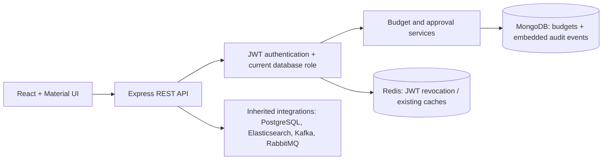

# Budget Management — Portfolio V2

A Node.js/Express and React budget management application extended with financial
analysis, role-based approvals, and persistent audit history. V2 focuses on business
rules, authorization, concurrent updates, and testable data consistency.

## Attribution and license

This repository builds on **Son Nguyen's
[Budget-Management-Backend-API](https://github.com/hoangsonww/Budget-Management-Backend-API)**.
The original copyright notice and [MIT license](LICENSE) are preserved. Existing
CRUD, authentication/passkeys, React screens, database adapters, messaging examples,
and deployment templates originate from that project. They are not claimed as
independently developed V2 work.

The independently developed V2 extensions in this fork are:

- **Budget vs. Actual:** authenticated reporting API and dashboard, monthly/category
  filters, remaining balance and signed variance, with tested empty/error states.
- **Multi-level approvals and RBAC:** Employee, Manager and Finance Admin roles;
  scoped inboxes; configurable thresholds; state/version-checked decisions;
  mandatory rejection reasons; idempotent creation; self-approval prevention.
- **Persistent Audit Trail:** budget creation, edits, submissions, approvals,
  rejections and soft deletion; actor/action/target/timestamp and before/after
  snapshots; scoped, filtered, paginated Audit History UI.
- Supporting authentication fixes, workflow bypass protection across the Node
  REST/gRPC interfaces, and automated security/consistency tests.

## Architecture



The primary backend entry is `index.js`; React starts at `frontend/src/index.js`.
Routes call controllers and shared approval/audit services. MongoDB remains the
source of truth for budgets, expenses, users and approval requests. PostgreSQL
transaction records are separate from expenses and audit evidence. Kafka and
RabbitMQ have application integration points, but the audit feature does not
depend on their delivery or console logs. Java/Spring and .NET directories are
separate inherited implementations; V2 changes target the Node/React application.

### Audit consistency and retention

Audit events are embedded in the **same Budget document** as business state.
Creation saves both together. An edit/transition atomically applies the business
change, version increment, and audit/history append. Validation or persistence
failure prevents the entire write; stale/duplicate transitions append nothing.
This works with standalone MongoDB and needs no extra collection, queue or
replica-set transaction. An idempotent create retry returns the existing record.

Legacy REST/gRPC budget deletion now sets `deletedAt` and appends a deletion event
in one write. The document and expense references survive; ordinary budget reads
and analysis exclude deleted budgets. Workflow-managed budgets remain protected
from generic modification/deletion. Secondary cache/event failures do not turn an
already committed legacy budget mutation into a reported failure.

Events contain only allowlisted budget fields, not raw requests, passwords, JWTs,
request keys, arbitrary user objects or review comments. Actor IDs/roles and
timestamps are generated server-side. Before/after snapshots include relevant
name, amount, assignment, approval state/policy and deletion fields. Do not enter
secrets into budget names: business text is retained as business data.

There are no audit create/update/delete HTTP endpoints. Employees read their own
request events; Managers read assigned requests after submission (including their
earlier events); Finance Admins read all events, including deleted legacy budgets.
Shared budget responses omit private approval and audit arrays.

## Local setup

Validated toolchain: Node.js **24.22.1**, npm **11.9.0**, MongoDB **6**. Use the
committed lockfiles. Existing CI/Docker templates pin older Node versions; they
have not been upgraded or newly deployment-validated by this extension.

```sh
npm ci
cd frontend
npm ci
cd ..
# Create a local ignored configuration only if one does not already exist.
test -e .env || cp .env.example .env
```

Configure `.env` with your service URLs and a strong `JWT_SECRET`; never commit
credentials. Production startup rejects a missing/default signing secret. The
new request/approval/audit workflows require MongoDB and Redis. For the **full
inherited application**, also provide PostgreSQL, RabbitMQ, Kafka and Elasticsearch.
The existing root Compose file is incomplete for that full stack: it does not
include PostgreSQL/Elasticsearch and has not been validated as a complete V2 setup.

| Setting | Purpose |
| --- | --- |
| `MONGO_DB_URI` | MongoDB database URL |
| `REDIS_URL` | Redis URL for authentication revocation and legacy caches |
| `JWT_SECRET` | Private JWT signing secret |
| `POSTGRES_URL` | Separate inherited transaction database |
| `RABBITMQ_URL`, `KAFKA_BROKER`, `ELASTIC_SEARCH_URL` | Inherited queue/event/search integrations |
| `BUDGET_FINANCE_APPROVAL_THRESHOLD` | Nonnegative amount, maximum two decimals; default `0` requires finance for every request |
| `PORT`, `GRPC_PORT` | Backend listeners, defaults 3000 and 50051 |
| `REACT_APP_API_URL` | Frontend build/start-time API base URL; set explicitly for local development |

The validated full local instance used MongoDB6, Redis7, PostgreSQL16,
RabbitMQ3-management, Kafka3.9.1 and Elasticsearch7.17.28. No new infrastructure
is required for audit persistence. Runtime secrets/processes are not included in
this repository. Start with a disposable development database: the inherited
entry point initializes the PostgreSQL schema and seeds sample data automatically.
Those seed records are not retrospective audit evidence.

```sh
# Terminal 1, repository root (after configuring services / .env)
npm start
# Terminal 2
cd frontend
PORT=3001 REACT_APP_API_URL=http://localhost:3000 npm start
```

Register users through the existing UI/API. Public registration always creates an
Employee. A trusted database operator assigns existing accounts' reviewer roles:

```sh
node scripts/set-user-role.js <existing-user-id> manager
node scripts/set-user-role.js <existing-user-id> finance_admin
```

Select an assigned Manager when creating a draft at `/budget-requests`. The normal
lifecycle is `DRAFT → SUBMITTED → MANAGER_APPROVED → FINANCE_APPROVED → FINAL_APPROVED`.
Finance review and finalization are separate authorized actions; a Finance Admin
may perform both. Below an explicitly configured threshold, manager approval
automatically records the remaining stages with system actors. Policy is
snapshotted at submission. Rejection requires a reason and is terminal.

## V2 API reference

Send `Authorization: Bearer <JWT>` for every endpoint below. Authorization uses
the account's current MongoDB role, not caller-supplied role claims.

| Endpoint | Behavior |
| --- | --- |
| `GET /api/budgets/analysis?month=YYYY-MM&category=<name>` | Summary and per-budget budget/actual/remaining/variance |
| `GET /api/budget-requests?view=mine\|pending\|history` | Scoped requests and current policy |
| `GET /api/budget-requests/reviewers` | Manager IDs/usernames for draft assignment |
| `POST /api/budget-requests` | Create `{name, limit, assignedManager, requestKey}`; reuse a UUID key on retry |
| `GET /api/budget-requests/:id` | Scoped request and workflow history |
| `PATCH /api/budget-requests/:id` | Edit own draft: name, limit, assignment, `expectedVersion` |
| `POST /api/budget-requests/:id/submit` | Submit own draft |
| `POST /api/budget-requests/:id/approve` | Authorized manager/finance review |
| `POST /api/budget-requests/:id/reject` | Reject with mandatory `comment` |
| `POST /api/budget-requests/:id/finalize` | Finance final approval |
| `GET /api/audit-trail` | Authorized, newest-first audit records and pagination |

Transitions include `expectedVersion` from the current document's `__v` and an
optional `comment` (required for rejection). Invalid/stale transitions return HTTP 409;
they do not change business state or append evidence. Finance Admin legacy CRUD
remains available through `/api/budgets`; request-backed budgets cannot bypass
their workflow through those endpoints. Node gRPC requires Bearer authorization
metadata and applies equivalent budget-write restrictions.

Analysis uses UTC expense months and **full** budget limits, not prorated monthly
allocations. Categories are existing budget names, not a separate taxonomy.
Remaining = budget − actual; variance = actual − budget. Negative remaining and
positive overspending variance are retained. Amounts are displayed in USD; no
currency conversion is implemented.

Audit query parameters:

| Parameter | Meaning |
| --- | --- |
| `targetId` | Exact 24-character MongoDB budget/request ID |
| `action` | `BUDGET_CREATED`, `BUDGET_MODIFIED`, `BUDGET_SUBMITTED`, `BUDGET_APPROVED`, `BUDGET_REJECTED`, or `BUDGET_DELETED` |
| `from`, `to` | Valid `YYYY-MM-DD` dates; both include the entire UTC day |
| `page`, `pageSize` | Positive integers; defaults 1/20, maximum page size 100 |

The audit response contains `records`, `page`, `pageSize`, `total`, `totalPages`.
Each record contains `_id`, `actorId` (null for policy automation), `actorRole`,
`action`, `targetId`, `timestamp`, `before`, and `after`. Approvals share the
`BUDGET_APPROVED` action; before/after status identifies the specific stage.
Invalid filters return HTTP 400. Inaccessible target searches return an empty scoped
result rather than revealing whether another user's request exists. `/audit-history`
provides these filters and pagination in React. Swagger is served at `/docs`.

## Tests and verification

```sh
# Backend regression/security/policy tests. Opt-in Mongo suites otherwise skip.
PORT=0 npm test -- --runInBand
# Run all real-Mongo suites against disposable per-process test databases.
PORT=0 MONGO_TEST_URI=mongodb://127.0.0.1:27017 npm test -- --runInBand
PORT=0 npm run test:mocha
cd frontend
npm test -- --runInBand
REACT_APP_API_URL=http://localhost:3000 npm run build
```

The Mongo suites create/drop only their own test databases; use a test server
where those operations are authorized. `PORT=0` avoids collisions from the
inherited application's listener during tests.

Verified on 2026-11-09 in the current local cloud instance:

| Check | Result |
| --- | --- |
| Backend Jest, including real MongoDB suites | **147 passed**, 0 failed, 0 skipped |
| Backend Mocha regression suite | **7 passed**, 0 failed |
| Frontend Jest / React Testing Library | **25 passed**, 0 failed |
| React production build (`CI=true`) | Passed |
| Chromium with built React + live Express/MongoDB/Redis | Passed: scoped reads, lifecycle evidence, before/after, soft-delete retention, ID/action/UTC-date filters, pagination, empty/clear states |
| MIT/license and new-file secret review | License unchanged; no new exposed credentials identified |

These are current-instance checks, not a claim of deployment or production-scale
validation. Browser fixtures were temporary and removed after verification.

- Automated coverage includes role/assignment permissions, lifecycle, rejection,
  self-approval, duplicate requests/decisions, threshold snapshots, shared API
  bypasses, audit persistence, before/after data, pagination, UTC filters, and
  validation/database failures that leave business state and audit unchanged.
- Frontend tests cover filters, pagination, loading, empty/error/retry handling
  and stale responses, alongside existing approval/analysis UI regressions.
- Browser checks use the built React bundle and actual local services. Public
  hosted deployments are not updated by these commits.

## Known limitations and security review

- Embedded audit arrays share MongoDB's 16MB document limit. There is no archival
  policy or unlimited retention. Writes fail rather than dropping evidence.
- Audit is append-only through application APIs, **not tamper-proof against a
  privileged database operator**. Records predating this feature and seed data
  are not backfilled. Coverage is budget/request actions, not expense/auth/user
  administration or a complete financial ledger.
- Business writes and audit are atomic; inherited caches, Elasticsearch and Kafka
  do not gain cross-system transactions. Pagination has deterministic ordering,
  but page offsets can shift when new events arrive between requests.
- Source/config review found development/default/example credentials in Node,
  Compose, Kafka and Java configurations. No recognizable live provider key,
  private key or complete JWT was found in the scanned tracked plaintext. This
  was not a history scan, live credential validation or a guarantee that no
  secret exists. No credentials were deleted or rotated.
- The main backend keeps TLS verification enabled. gRPC still uses plaintext
  transport and needs a trusted network/TLS termination. Use restricted CORS,
  rate limiting and security headers before public production exposure.
- Frontend JWTs remain in localStorage; UI logout currently clears local state
  without calling the available server token-revocation endpoint. Legacy GraphQL
  and notification routes remain public. Kafka logs some full business event
  payloads; comprehensive operational-log redaction is not implemented.
- The insecure unverified password-reset API is intentionally disabled (501).
  Verified email recovery is not configured. Existing deployment/monitoring
  templates and alternate backends have not been newly production-validated.

The [earlier README](.github/README.md) is retained for historical reference;
its broad inherited technology/deployment claims are not V2 verification evidence.
